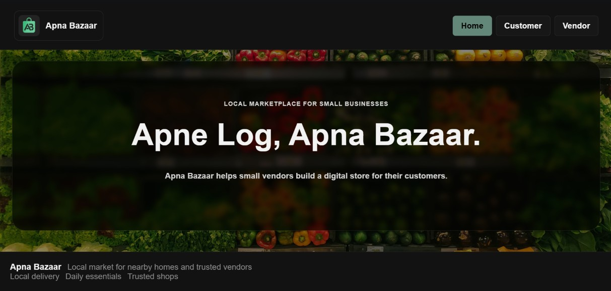

# Apna Bazaar
https://nimai-hk.github.io/Local-Market-Online-Store-for-Small-Vendors/

A simple local market storefront for small vendors. The project is a front-end demo for browsing daily essentials, adding items to a cart, and placing an order.

## Pages
- Main page: landing section with local product categories and vendor cards
- Categories page: product lists for groceries, plants and pots, stationery, and snacks
- Checkout page: customer details and order summary

## What the website does
- Shows basic local market categories and everyday products
- Lets users add items to the cart with quantity controls. The cart updates to show cost.
- Displays local vendor information on the home page
- Accepts customer details like name, phone number, email, and address and places a mock order

## Project structure
- index.html — page structure
- style.css — page styling, and styling of header, footer and cards (div and articles)
- script.js — logic to switch between sections or divs, and data of category items.

## Project Members:
<table style="width:100%; border-collapse:collapse;">
  <tr>
    <th style="text-align:center;">Name</th>
    <th style="text-align:center;">Roll No</th>
    <th style="text-align:center;">Registration No.</th>
    <th style="text-align:center;">Section</th>
  </tr>
  <tr>
    <td style="text-align:center;">Mohit Kumar</td>
    <td style="text-align:center;">RK2P26GUA06</td>
    <td style="text-align:center;">12601077</td>
    <td rowspan="3" style="text-align:center; vertical-align:middle;">K2P26GU</td>
  </tr>
  <tr>
    <td style="text-align:center;">Nimai Hithesh</td>
    <td style="text-align:center;">RK2P26GUA03</td>
    <td style="text-align:center;">12606037</td>
  </tr>
  <tr>
    <td style="text-align:center;">Mukilan</td>
    <td style="text-align:center;">RK2P26GUA07</td>
    <td style="text-align:center;">12601400</td>
  </tr>
</table>

### Copyrights Notice and Disclaimer

<b>Copyright Notice and Disclaimer (Click to Expand)</b>

Certain images used in this project may be protected by copyright and are the property of their respective owners. These images are included solely for educational, informational, or other non-commercial purposes and no ownership is claimed by us.

If any copyright owner believes that their material has been used improperly and contacts us with a valid request, we will promptly review the claim and, where appropriate, remove the relevant content without undue delay.

Nothing in this notice shall be construed as a waiver of any legal rights or remedies available to copyright owners. We do not seek to limit or exclude liability where such exclusion is prohibited by applicable law. Any concerns regarding copyrighted material should be communicated to us for prompt resolution.

